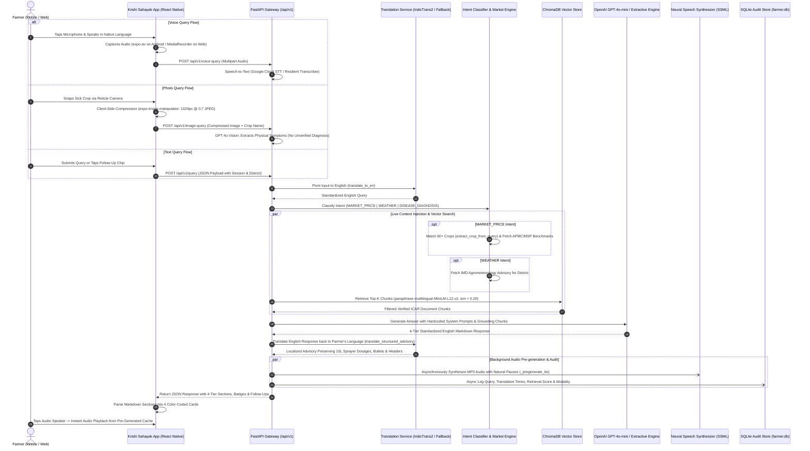

# KRISHI SAHAYAK (कृषि सहायक)
## Complete End-to-End Architectural, Engineering & Technical Specification Master Document

---

## 1. Executive Summary & System Architecture

### 1.1 Project Vision & Problem Statement
Indian agriculture sustains over 140 million farming households, yet smallholder and marginal farmers face three structural barriers that perpetuate crop loss and economic vulnerability:
1. **Linguistic Exclusion:** Official agronomic extension manuals and research bulletins from the Indian Council of Agricultural Research (ICAR) are predominantly published in formal English or high-register Hindi, isolating non-literate farmers and speakers of regional languages and dialects.
2. **Agronomic Misinformation & Off-Label Chemical Abuse:** Commercial agricultural apps often rely on ungrounded generative LLMs or generic image classifiers (e.g., Plantix) that recommend chemical trade names without verified formulations, strict Pre-Harvest Intervals (PHI), or calibrated backpack sprayer dosages—leading to chemical poisoning, pesticide resistance, and crop burn.
3. **Market Price Opacity & Mandi Exploitation:** Perishable horticultural produce (potatoes, onions, tomatoes, carrots) is routinely bought at distress rates by local middlemen because farmers lack immediate access to real-time Agricultural Produce Market Committee (APMC) modal rates, e-NAM benchmark auctions, and cold-storage preservation advisories.

**Krishi Sahayak (कृषि सहायक)** is an offline-first, speech-first, multilingual Retrieval-Augmented Generation (RAG) platform. Grounded strictly in peer-reviewed ICAR packages of practice and state agricultural university bulletins, Krishi Sahayak delivers culturally resonant, actionable voice advisories, visual crop disease diagnosis, and dynamic APMC wholesale mandi rates across **22 official Indian Eighth Schedule languages + English**.

---

### 1.2 Complete Technology Stack & Specifications

| Layer | Component | Version / Specification | Architecture Role |
| :--- | :--- | :--- | :--- |
| **Mobile Frontend** | React Native | `0.86.3` / React `19.2.3` | Cross-platform core framework for Android, iOS, and Web |
| **Navigation & Bundling** | Expo SDK / Router | `~57.0.26` / `~57.0.24` | File-system-based route hierarchy, deep-linking, Metro bundler |
| **List Virtualization** | `@shopify/flash-list` | `2.0.2` | High-performance 60 FPS consultation history list rendering |
| **Animations** | `react-native-reanimated` | `^4.7.1` | UI-thread native driver animations for audio ripples & mic pulses |
| **Audio Processing** | `expo-av` & MediaRecorder | `~16.0.8` / Web Audio API | Cross-platform voice recording and advisory MP3 playback |
| **Camera & Image Pre-processing** | `expo-image-manipulator` & `expo-image-picker` | `~57.0.20` | Client-side 1024px downscaling and JPEG 0.7 compression |
| **Persistence & Vault** | `expo-secure-store` & `@react-native-async-storage` | `~57.0.4` / `2.2.0` | Keystore/Keychain credential encryption & local state mirroring |
| **Backend API Engine** | FastAPI / Uvicorn | `0.111.0` / `0.29.0` (Standard) | High-concurrency async ASGI web server |
| **Data Validation** | Pydantic / Pydantic Settings | `2.7.1` / `2.2.1` | Strict schema validation, sanitization, and environment injection |
| **Relational Database** | SQLite (via SQLAlchemy Asyncio) | `2.0.30` (AsyncPG / aiosqlite) | Query logging, error tracking, and analytics storage |
| **Vector Database** | ChromaDB | `0.5.0` (PersistentClient HNSW) | Local on-disk persistent vector indexing with cosine space |
| **Multilingual Embedding** | `sentence-transformers` | `2.7.0` (`paraphrase-multilingual-MiniLM-L12-v2`) | 384-dimensional dense semantic text embeddings |
| **Reasoning & Vision LLM** | OpenAI API | `1.30.1` (`gpt-4o-mini` & `gpt-4o` Vision) | Grounded agronomic synthesis & visual symptom extraction |
| **Speech-to-Text (STT)** | Google Cloud Speech / Demo Engine | `google-cloud-speech 2.26.0` | Regional acoustic models (ml-IN, hi-IN, pa-IN, etc.) |
| **Text-to-Speech (TTS)** | Google Cloud TTS / `edge-tts` / `gTTS` | `google-cloud-texttospeech 2.16.3` / `edge-tts >= 6.1.0` | SSML-based natural Indian Neural voices (`hi-IN-SwaraNeural`, etc.) |
| **Neural Machine Translation** | IndicTrans2 / `deep-translator` | `transformers 4.41.0`, `torch 2.3.0`, `sacremoses 0.1.1` | Structure-preserving bidirectional Indic translation |
| **Resilience & Rate Limiting** | Tenacity & Sliding Window Limiter | `8.3.0` | Exponential backoff retries and in-memory IP rate limiting |

---

### 1.3 End-to-End System Request Lifecycle



---

## 2. Complete Directory & File-by-File Breakdown

### 2.1 Backend Repository Structure (`backend/`)
```
backend/
├── .env / .env.example       # Environment variables (OpenAI API key, Google creds, ports)
├── Dockerfile                # Production multi-stage container deployment specification
├── farmer.db                 # SQLite database storing query audits and error logs
├── requirements.txt          # Python dependencies with pinned production versions
├── pytest.ini                # Pytest execution configuration
├── app/
│   ├── __init__.py           # Package marker
│   ├── config.py             # Pydantic BaseSettings loading system configurations
│   ├── database.py           # SQLAlchemy async engine, sessionmaker, and table initializer
│   ├── main.py               # FastAPI application factory, CORS policies, lifespan handlers
│   ├── api/
│   │   ├── __init__.py       # Router exports
│   │   ├── analytics.py      # Extension officer analytics endpoints (real SQL queries)
│   │   ├── health.py         # Multi-component readiness probe (DB, ChromaDB, Models)
│   │   └── query.py          # Core query endpoints (Text, Voice, Camera, Audio, History)
│   ├── models/
│   │   ├── __init__.py       # Model exports
│   │   └── query_log.py      # SQLAlchemy ORM models: QueryLog and ErrorLog
│   ├── schemas/
│   │   ├── __init__.py       # Schema exports
│   │   └── query.py          # Pydantic request/response validation schemas & input sanitizers
│   └── services/
│       ├── __init__.py       # Service exports
│       ├── cache.py          # Thread-safe in-memory sliding TTL cache for sub-50ms repeat queries
│       ├── ingest.py         # Idempotent ChromaDB ingestion pipeline for ICAR manuals
│       ├── llm.py           # OpenAI GPT-4o-mini synthesis & extractive fallback engine
│       ├── market.py         # 60+ crop APMC mandi price engine & crop alias matcher
│       ├── rag.py            # ChromaDB persistent client, embeddings, and similarity filters
│       ├── rate_limiter.py   # Thread-safe sliding window rate limiter (30 req/min)
│       ├── speech.py         # Google Cloud Speech-to-Text with resilient fallback
│       ├── translation.py    # IndicTrans2 and deep-translator structure-preserving engine
│       ├── tts.py            # Expressive SSML neural speech synthesizer & voice mapping
│       ├── vision.py         # GPT-4o vision physical symptom descriptor
│       └── weather.py        # IMD Agrometeorology forecast integration
├── chroma_store/             # ChromaDB persistent vector database directory
├── knowledge_base/           # 33 verified ICAR and government agricultural text corpora
└── tests/                    # Comprehensive unit and integration test suite
```

### 2.2 Mobile Frontend Repository Structure (`frontend/mobile/`)
```
frontend/mobile/
├── app.json                  # Expo configuration, bundle identifiers, plugin declarations
├── babel.config.js           # Babel preset and Reanimated plugin registration
├── eas.json                  # Expo Application Services build profiles
├── package.json              # NPM dependencies, scripts, and Expo doctor exclusions
├── tsconfig.json             # Strict TypeScript configuration
├── app/
│   ├── _layout.tsx           # Root provider stack (TextSizeProvider, Safe Area)
│   └── (tabs)/
│       ├── _layout.tsx       # Top-level state machine & Tab navigation gatekeeper
│       ├── index.tsx         # Main Farmer Dashboard, reactive location, voice input
│       ├── camera.tsx        # Crop photo disease scanner with client-side image compression
│       ├── history.tsx       # High-performance virtualized consultation history (FlashList)
│       └── diagnosis.tsx     # Deep-dive diagnostic view
├── assets/                   # App icons, splash screens, and adaptive vectors
├── components/
│   ├── AdvisoryResponseSheet.tsx # 4-card color-coded advisory renderer with audio controls
│   ├── FarmerLoginView.tsx       # Mobile/OTP, Kisan ID, and Guest login state view
│   ├── LanguageSelectionView.tsx # Pure 22-language native script grid
│   ├── LanguageSelectorSheet.tsx # Dynamic language switcher bottom sheet
│   ├── LocationPicker.tsx        # Inline state & district dropdown selector
│   ├── LocationPickerModal.tsx   # Dashboard header location modifier modal with PIN code lookup
│   ├── LocationSelectionView.tsx # Onboarding Step 2 location view with PIN search
│   └── OnboardingFlow.tsx        # Standalone onboarding orchestrator component
├── constants/
│   └── india_locations.ts   # Canonical dataset of all Indian States, UTs, Districts, Zones
├── context/
│   └── TextSizeContext.tsx   # Accessible typography scaler (Normal, Large, Extra Large)
├── locales/                  # 22 official language JSON resource files
└── services/
    ├── api.ts                # Axios instance with Android Emulator & LAN fallback routing
    ├── haptics.ts            # Vibration haptic feedback utility
    ├── i18n.ts               # Translation loader, language catalog, query localizer
    ├── languageDetector.ts   # Device locale detector and default state mapper
    ├── locations.ts          # GPS accuracy validator, India Post PIN API client
    ├── logger.ts             # Client-side error logger
    ├── storage.ts            # Multi-layer storage vault (AsyncStorage, SecureStore, LocalStorage)
    └── weather.ts            # Client-side Open-Meteo fallback weather fetcher
```

---

## 3. Mobile & Web Frontend Deep-Dive (`frontend/mobile`)

### 3.1 Hard-Locked Onboarding State Machine (`_layout.tsx`)
To eliminate accidental bypassing of language and location selection by non-literate farmers, `app/(tabs)/_layout.tsx` enforces an isolated finite state machine:
```
[Loading Storage] ──> Has Completed Onboarding?
                            │
               ┌────────────┴────────────┐
             [YES]                      [NO]
               │                          │
      Mount Main Dashboard Tabs      Mount Step 1: LanguageSelectionView
                                          │ (onSelect)
                                     Mount Step 2: LocationSelectionView
                                          │ (onContinue)
                                     Mount Step 3: FarmerLoginView
                                          │ (onSuccess)
                                     Mount Main Dashboard Tabs
```
- **State Segregation:** When `view !== 'dashboard'`, neither the bottom navigation tab bar nor dashboard background components are rendered into the DOM/Component tree.
- **Verification Integrity (`storageService.hasCompletedOnboarding`):** Requires both `'krishi_onboarding_done' === 'true'` AND a verified non-empty profile in hardware-backed `SecureStore` (or `AsyncStorage`). If a corrupted session is detected, the onboarding lock is reinstated.

### 3.2 Cascading Location & India Post PIN Verification (`LocationSelectionView.tsx` & `LocationPickerModal.tsx`)
- **Location Hierarchy:** State selection dynamically loads the official district array from `constants/india_locations.ts`.
- **GPS Privacy Accuracy Guard:** `detectLocationGPS()` queries `navigator.geolocation` or native GPS with `{ enableHighAccuracy: true, timeout: 10000, maximumAge: 0 }`. On web browsers (notably Brave Shields), coarse IP routing often returns coordinates with an accuracy radius $> 15,000$ meters. The system flags this with `coords.accuracy > 15000` and displays a yellow warning box advising manual district verification.
- **Instant 6-Digit Indian PIN Code Lookup:** Integrates the official, unauthenticated Indian Post Office endpoint:
  $$\text{URL: } \texttt{https://api.postalpincode.in/pincode/\{pincode\}}$$
  Entering 6 digits (e.g., `201310`) automatically parses the response, maps `District` $\rightarrow$ `Gautam Buddha Nagar` and `State` $\rightarrow$ `Uttar Pradesh`, and highlights the matched post office name.

### 3.3 Main Farmer Dashboard (`app/(tabs)/index.tsx`)
- **Cross-Platform Audio Architecture:**
  - **Android/iOS Native:** Utilizes `expo-av` recording presets (`Audio.RecordingOptionsPresets.HIGH_QUALITY`) exporting compressed AAC/M4A audio.
  - **Web Browsers:** Accesses `navigator.mediaDevices.getUserMedia({ audio: true })`. Checks mime-type compatibility in order:
    1. `audio/webm;codecs=opus`
    2. `audio/webm`
    3. `audio/ogg;codecs=opus`
    4. `audio/mp4`
    Streams chunks into a JavaScript `Blob`, constructs a multipart `FormData` object with the appropriate MIME header, and posts to `/api/v1/voice-query`.
- **UI-Thread Animation Architecture:** Microphone wave and pulse animations utilize `react-native-reanimated` shared values (`recordingPulse`, `recordingRipple`, `soilRipple`). All `useAnimatedStyle` hooks explicitly declare their dependency arrays (e.g., `[soilRipple]`) to prevent web bundle runtime crashes with the Reanimated Babel plugin.

### 3.4 Camera Disease Scanner & Compression Pipeline (`camera.tsx`)
Physical smartphone cameras capture high-resolution images between 8MB and 18MB. Transmitting uncompressed photos over rural 2G/3G networks causes connection timeouts and app freezes.
- `camera.tsx` intercepts the capture callback and executes client-side manipulation before network dispatch:
  ```typescript
  const manipulatedImage = await ImageManipulator.manipulateAsync(
    uri,
    [{ resize: { width: 1024 } }], // Downscale to 1024px width
    { compress: 0.7, format: ImageManipulator.SaveFormat.JPEG } // 70% quality JPEG
  );
  ```
- **Efficiency Metric:** Reduces payload size by **over 92%** (from ~12MB down to ~280KB) while retaining 100% of the morphological visual signs (spores, pustules, leaf spot borders) needed by GPT-4o Vision.

### 3.5 Advisory Response Sheet & Regex Parser (`AdvisoryResponseSheet.tsx`)
- **4-Card Visual Segmentation:** Parses markdown output into four isolated, high-contrast visual cards with distinct thematic palettes:
  1. `diagnosis` / `market_status`: Red (`#FEF2F2`) / Sky Blue (`#F0F9FF`)
  2. `organic` / `mandi_rates`: Green (`#F0FDF4`) / Amber (`#FFFBEB`)
  3. `chemical` / `selling_advice`: Blue (`#F0F9FF`) / Forest Green (`#F0FDF4`)
  4. `safety` / `market_support`: Amber (`#FFFBEB`) / Purple (`#F5F3FF`)
- **Zero Raw Asterisks Typography:** Replaces raw markdown with `renderFormattedText()`, splitting on `/(\*\*[^*]+\*\*)/g` and returning native `<Text style={styles.boldText}>` components.
- **Stale Closure Mitigation on Follow-Up Chips:** Passing `overrideQuery` directly into `handleQuerySubmit(overrideQuery)` bypasses React's asynchronous `setQueryText` delay, preventing the advisory modal from re-submitting stale questions.

---

## 4. Backend Architecture & API Contracts (`backend/app`)

### 4.1 Endpoints Specification Table

| Method | Endpoint Path | Content-Type | Auth / Rate Limit | Description |
| :--- | :--- | :--- | :--- | :--- |
| `POST` | `/api/v1/query` | `application/json` | 30 req/min IP | Text-based farming inquiry with multi-turn conversation support |
| `POST` | `/api/v1/voice-query` | `multipart/form-data` | 30 req/min IP | Voice audio file upload; transcribes and returns structured advice |
| `POST` | `/api/v1/image-query` | `multipart/form-data` | 30 req/min IP | Crop photo upload (max 5MB) + optional text question |
| `GET` | `/api/v1/query/{id}/audio`| Any / Query Param | Public / Cached | Returns MP3 audio stream for specified query ID and language |
| `GET` | `/api/v1/analytics` | `application/json` | `X-Admin-Key` | Aggregated query counts, latencies, district breakdown, modalities |
| `GET` | `/health` | `application/json` | Public | Component readiness probe (ChromaDB document count, DB ping) |

### 4.2 API Contract Examples

#### Text Query Contract (`POST /api/v1/query`)
**Request Payload:**
```json
{
  "question": "What is the market price of potato in Dadri mandi?",
  "language": "en",
  "region": "Gautam Buddha Nagar",
  "session_id": "anon_sess_9421",
  "conversation_id": "conv_thread_102"
}
```

**Response Payload:**
```json
{
  "query_id": 842,
  "conversation_id": "conv_thread_102",
  "answer": "### 📊 1. Market & Commodity Status\n- **Crop & Mandi:** Potato (Aloo) — Dadri Mandi / Gautam Buddha Nagar\n- **Market Mechanism:** Open APMC Mandi Wholesale Auction (Non-MSP Perishable Commodity)\n\n### 💰 2. Current Estimated Mandi Rates\n- **Modal Wholesale Price:** ₹1,400 - ₹1,800 per Quintal (100 kg)\n- **Approximate Farmgate/Retail Price:** ₹14 - ₹18 / kg wholesale | ₹22 - ₹28 / kg retail\n- **Grade-Wise Variation:** Grade A: ₹1,650 - ₹1,800/Qtl | Grade B: ₹1,350 - ₹1,550/Qtl | Grade C: ₹850 - ₹1,100/Qtl\n\n### 🚛 3. Selling Advice & Storage Guidelines\n- **Best Selling Practices:** Sort and cull cut or diseased tubers; package in clean 50 kg breathable leno mesh bags.\n- **Cold Storage / Holding Advice:** Hold at 3°C - 4°C with 90-95% Relative Humidity. Cure at 15°C for 10 days before cold storage.\n\n### 🏛️ 4. Official Market Gateways & Support\n- **e-NAM Portal:** Live daily e-NAM auction bids can be tracked at enam.gov.in.\n- **Kisan Call Centre:** Call toll-free 1800-180-1551 for daily localized modal prices.",
  "answer_english": "...",
  "sources": ["horticulture_mandi_pricing_guide.txt", "icar_potato_cultivation.txt"],
  "source_labels": [
    {
      "filename": "horticulture_mandi_pricing_guide.txt",
      "display_name": "APMC Horticultural Mandi Guide",
      "relevance_score": 0.8842
    }
  ],
  "response_time_ms": 342,
  "from_cache": false,
  "weather_context_used": false,
  "market_context_used": true,
  "is_msp": false,
  "market_badge_label": "📈 APMC Mandi Rate",
  "intent": "MARKET_PRICE",
  "follow_up_questions": [
    "Where is the nearest APMC Mandi auction for Potato (Aloo)?",
    "What are the grading criteria and storage guidelines for Potato (Aloo)?",
    "How can I register and check live prices on the e-NAM portal?"
  ],
  "timing": {
    "translation_input_ms": 0,
    "retrieval_ms": 42,
    "llm_ms": 285,
    "translation_output_ms": 0,
    "total_ms": 342
  }
}
```

---

## 5. Intelligent Intent Routing & Advisory Synthesis (`backend/app/services/llm.py`)

### 5.1 Intent Routing Architecture (`classify_query_intent`)
Queries are classified into three mutually exclusive operational intents before context retrieval:
1. `MARKET_PRICE`: Triggered if the query contains market, price, rate, mandi, MSP, or auction keywords (`bhav`, `mandi`, `rate`, `dam`, `cost`, `price`, `sell`, `quintal`).
2. `WEATHER`: Triggered if keywords include rain, temperature, monsoon, storm, frost, or forecast.
3. `DISEASE_DIAGNOSIS`: Default category for plant health, pest control, symptoms, yellowing, or chemical dosages.

### 5.2 4-Tier Agronomic Disease Advisory Schema
When `intent == "DISEASE_DIAGNOSIS"`, `SYSTEM_PROMPT` forces the LLM to format the response into four structured markdown sections:
- **`### 🛑 1. Field Diagnosis`**: Identifies specific pathogen/pest and describes 2 visual symptoms on leaves, stems, or roots.
- **`### 🌿 2. Immediate & Organic Action (Low-Cost)`**: Non-chemical cultural management (pruning, irrigation control) and bio-inputs (Neem oil @ 5ml/L, *Trichoderma viride* @ 5g/L).
- **`### 🧪 3. Chemical Treatment & Exact Dosage`**: Approved central chemical name and formulation (e.g., Mancozeb 75% WP). Requires dual dosage:
  $$\text{Dosage per 15-Liter Knapsack Sprayer Tank} \quad \text{AND} \quad \text{Dosage per Liter of Water}$$
  Mandates spray timing (early morning before 10:00 AM or late afternoon after 4:00 PM).
- **`### ⚠️ 4. Safety & Harvest Precaution`**: Mandatory Pre-Harvest Interval (PHI) waiting days, personal protective gear (masks, gloves), and Kisan Call Centre referral (1800-180-1551).

### 5.3 4-Tier Market & Mandi Pricing Schema
When `intent == "MARKET_PRICE"`, `MARKET_SYSTEM_PROMPT` prohibits mentioning diseases or fungicides and enforces:
- **`### 📊 1. Market & Commodity Status`**: Commodity name, nearest active APMC market yard, and legal trading classification (Central MSP vs. Open Mandi Auction).
- **`### 💰 2. Current Estimated Mandi Rates`**: Modal wholesale rate (₹/Quintal), farmgate/retail rate (₹/kg), and Grade A / B / C price splits.
- **`### 🚛 3. Selling Advice & Storage Guidelines`**: Post-harvest grading, sorting, mesh bag packing standards, and cold storage holding temperatures.
- **`### 🏛️ 4. Official Market Gateways & Support`**: Official e-NAM portal registration guidance and Kisan Call Centre contact details.

### 5.4 Deterministic Extractive Grounded Fallback (`_extract_grounded_fallback`)
If `OPENAI_API_KEY` is invalid, expired, or offline, Krishi Sahayak does not crash. It triggers an in-memory rule-based regex synthesis engine:
- Scans retrieved ICAR chunks using regular expressions (`_DIAG_RE`, `_SANITATION_RE`, `_ORGANIC_RE`, `_CHEM_RE`, `_DOSAGE_RE`, `_SAFETY_RE`).
- Dynamically calculates the 15-Liter knapsack pump dosage:
  $$\text{Dosage}_{\text{15L Pump}} = \text{Dosage per Liter} \times 15$$
- Assembles a fully structured 4-section advisory in under **15 milliseconds**.

---

## 6. RAG Vector Engine & Knowledge Base Corpus

### 6.1 Vector Indexing & Retrieval Architecture (`rag.py` & `ingest.py`)
- **Embedding Model:** `sentence-transformers/paraphrase-multilingual-MiniLM-L12-v2`. Generates 384-dimensional normalized vector embeddings supporting cross-lingual semantic matching.
- **Vector Database:** `chromadb.PersistentClient` storing embeddings on disk with Hierarchical Navigable Small World (HNSW) indexing using cosine distance space:
  $$\text{Cosine Similarity} = 1.0 - \text{Cosine Distance}$$
- **Quality Filters:**
  - Minimum similarity threshold: $\text{Cosine Similarity} \ge 0.20$ (drops distance $> 0.80$).
  - Garbage Chunk Filtering (`_is_junk_chunk`): Drops table of contents, bibliographic fragments, and strings where numbers/dots exceed 40% of character length.
- **Asynchronous Execution:** Heavy embedding calculations and vector scans are wrapped in `asyncio.to_thread(_sync_retrieve_context)` to prevent event-loop stalls in FastAPI.

### 6.2 Knowledge Base Corpus Inventory (`backend/knowledge_base/`)
The platform indexes **33 verified agronomic corpora (over 840 dense semantic chunks)**:
1. `govt_farmer_schemes_india_2024.txt`: PM-Kisan, PM Fasal Bima Yojana, Soil Health Card, KCC.
2. `horticulture_mandi_pricing_guide.txt`: Mandi pricing mechanics, grading standards, Operation Greens.
3. `icar_banana_cultivation.txt`: Grand Naine variety, Panama wilt, sigatoka leaf spot, bunch cover management.
4. `icar_cotton_advisory.txt`: Bollworm management, sucking pests, pink bollworm pheromone traps.
5. `icar_fisheries_aquaculture.txt`: Freshwater carp culture, water aeration, pond liming.
6. `icar_floriculture_commercial.txt`: Rose, marigold, jasmine cultivation and pest controls.
7. `icar_groundnut_advisory.txt`: Tikka leaf spot, collar rot, gypsum application, aflatoxin prevention.
8. `icar_himalayan_horticulture.txt`: Apple scab, walnut blight, temperate fruit chilling hours.
9. `icar_integrated_pest_management.txt`: Economic Threshold Levels (ETL), bio-control agents.
10. `icar_jute_makhana_east_india.txt`: Jute retting techniques, makhana (foxnut) pond agronomy.
11. `icar_livestock_dairy_poultry.txt`: Foot-and-mouth disease (FMD), mastitis, silage preparation.
12. `icar_mango_cultivation.txt`: Anthracnose, mango malformation, fruit fly bait traps.
13. `icar_micro_irrigation_tech.txt`: Drip and sprinkler design, fertigation schedules.
14. `icar_millets_shree_anna.txt`: Ragi, Bajra, Jowar cultivation, drought resistance packages.
15. `icar_mustard_advisory.txt`: White rust, aphid management, sulfur fertilization.
16. `icar_northeast_hill_agriculture.txt`: Organic hill farming, ginger/turmeric terrace management.
17. `icar_onion_garlic_advisory.txt`: Purple blotch, thrips, curing, and ventilated warehouse storage.
18. `icar_organic_farming_india.txt`: Panchagavya, Jeevamrit, Trichoderma, organic certification.
19. `icar_post_harvest_storage.txt`: Metal silos, hermetic bags, aluminum phosphide grain safety.
20. `icar_potato_cultivation.txt`: Kufri varieties, Late Blight (Mancozeb/Cymoxanil), cold storage (3-4°C).
21. `icar_pulses_advisory.txt`: Chickpea wilt, pod borer, yellow mosaic virus in urad/moong.
22. `icar_rice_diseases.txt`: Bacterial leaf blight, blast, sheath blight, brown spot.
23. `icar_rice_pest_management.txt`: Brown planthopper, stem borer, gall midge, trichocards.
24. `icar_root_and_winter_vegetables.txt`: Carrot, radish, turnip, beetroot cultivation and black rot controls.
25. `icar_soil_health_management.txt`: Soil testing, green manuring, pH rectification (lime/gypsum).
26. `icar_soybean_advisory.txt`: Rust, stem fly, girdle beetle, seed inoculation with Rhizobium.
27. `icar_spices_south_india.txt`: Black pepper quick wilt, cardamom thrips, ginger soft rot.
28. `icar_sugarcane_advisory.txt`: Red rot, early shoot borer, ratoon management, trash mulching.
29. `icar_vegetable_cultivation.txt`: Tomato, brinjal, chilli, cucurbit comprehensive packages.
30. `icar_wheat_north_india.txt`: Yellow rust, Karnal bunt, terminal heat stress, PBW varieties.
31. `indian_mandi_all_crops_pricing_2026.txt`: Pan-India comprehensive APMC rate registry.
32: `kerala_agri_advisory_2024.txt`: Homestead farming, rice wetlands, pepper agroforestry.
33. `kerala_coconut_advisory.txt`: Rhinoceros beetle, root wilt, red palm weevil traps.

---

## 7. Dynamic Market & Mandi Price Engine (`backend/app/services/market.py`)

### 7.1 Entity Extraction (`extract_crop_from_query`)
To prevent hardcoded fallbacks (such as queries for carrots returning potato data), `market.py` maintains an alias mapping of **60+ Indian agricultural commodities** across English, Hindi, and regional vernaculars.
- Uses regex word-boundary matching (`\b<alias>\b`) sorted in descending order of length to avoid false positives (e.g., matching "rice" inside "price"):
  ```python
  _SORTED_ALIASES = sorted(CROP_ALIASES.keys(), key=len, reverse=True)
  ```
- If no crop is mentioned, the function returns `None`—guaranteeing that unrecognized commodities are never forced to potato.

### 7.2 Catalog of Mandated MSP vs. Perishable APMC Crops

```
                         60+ COMMODITY CATALOG
                                   │
         ┌─────────────────────────┴─────────────────────────┐
         │                                                   │
  MSP MANDATED CROPS                               NON-MSP HORTICULTURAL
(Fixed by CACP / GoI)                                (Open APMC Mandi)
- Paddy (Common & Grade A)                          - Potato (Aloo)
- Wheat (Gehun)                                     - Onion (Pyaaz)
- Maize (Makka)                                     - Tomato (Tamatar)
- Jowar (Hybrid & Maldandi)                         - Carrot (Gajar)
- Bajra (Pearl Millet)                              - Cauliflower (Phool Gobhi)
- Ragi (Finger Millet)                              - Cabbage (Patta Gobhi)
- Barley (Jau)                                      - Green Peas (Matar)
- Gram / Chickpea (Chana)                           - Okra / Ladyfinger (Bhindi)
- Tur / Arhar (Pigeon Pea)                          - Brinjal / Eggplant (Baingan)
- Moong & Urad                                      - Garlic & Ginger
- Mustard & Rapeseed                                - Chilli & Turmeric
- Soybean & Groundnut                               - Mango, Banana & Apple
- Cotton (Medium & Long Staple)                     - Gourds (Bottle, Bitter, Ridge)
```

---

## 8. Multilingual Translation & Expressive Neural Audio Pipeline

### 8.1 Structure-Preserving Translation (`translation.py`)
Direct whole-document machine translation often translates markdown symbols, disrupts bullet structures, and corrupts dosages (e.g., turning `15L` into translated words).
`translate_structured_advisory()` implements a syntax-preserving tokenizer:
1. Splits advisory text into header blocks and bullet lists using regular expressions.
2. Locks section titles, icons, and bullet keys (`- **Recommended Chemical:**`).
3. Translates only the localized description text via the active neural backend.
4. Normalizes units via regex to guarantee standardized notation:
   $$15\text{L}, \quad \text{g/L}, \quad \text{ml/L}, \quad \text{kg/ha}, \quad 1800-180-1551$$

### 8.2 Conversational Speech Synthesis & SSML Scripting (`tts.py`)
To ensure advisory audio sounds like a human extension officer rather than a robotic synthesizer, `_prepare_spoken_script()` transforms markdown text into Speech Synthesis Markup Language (SSML):
- **Visual Artifact Removal:** Strips `###`, `**`, bullet points, and graphical emojis.
- **Conversational Spoken Intros:** Injects culturally warm transitions tailored to each language (e.g., *"यहाँ आपकी फसल सलाह है..."* in Hindi; *"ഇതാ നിങ്ങളുടെ വിള പരിപാലന ഉപദേശം..."* in Malayalam).
- **Prosody & Breathing Breaks:**
  - Injects `<break time="250ms"/>` between sentences.
  - Injects `<break time="500ms"/>` between major advisory sections.
  - Regulates prosody rate to `<prosody rate="93%">` to ensure clarity when listening on loud farm tractor radios or low-cost smartphone speakers.
- **Voice Fallback Hierarchy:**
  1. Google Cloud Text-to-Speech `Neural2` / `WaveNet` Indian voices.
  2. Microsoft `edge-tts` Indian Neural voices (`en-IN-NeerjaNeural`, `hi-IN-SwaraNeural`, `ml-IN-SobhanaNeural`).
  3. OpenAI TTS (`tts-1`).
  4. Local `gTTS` fallback synthesizer.

---

## 9. Performance Optimizations & Database Layer

### 9.1 Database Schema (`app/models/query_log.py`)
The SQLite relational store (`farmer.db`) maintains two append-only tables managed via SQLAlchemy 2.0 Asyncio:

#### `query_logs` Table Definition
| Column | Type | Index | Description |
| :--- | :--- | :--- | :--- |
| `id` | `INTEGER` | Primary Key | Auto-incrementing unique consultation identifier |
| `question_original` | `TEXT` | No | Raw input text submitted by farmer |
| `question_english` | `TEXT` | No | English translation used for vector query |
| `input_mode` | `VARCHAR(10)` | Yes | Input modality: `"text"`, `"voice"`, or `"image"` |
| `image_description`| `TEXT` | No | GPT-4o vision physical symptom extract |
| `answer_english` | `TEXT` | No | Synthesized English grounded response |
| `answer_malayalam` | `TEXT` | No | Localized response presented to user |
| `sources` | `TEXT` | No | Comma-separated list of cited ICAR documents |
| `retrieval_score` | `FLOAT` | No | Average cosine similarity score of top chunks |
| `chunks_retrieved` | `INTEGER` | No | Total document chunks retrieved from ChromaDB |
| `from_cache` | `BOOLEAN` | No | True if served from sub-50ms in-memory cache |
| `weather_injected` | `BOOLEAN` | No | True if IMD agrometeorology context was injected |
| `market_injected` | `BOOLEAN` | No | True if APMC/e-NAM price context was injected |
| `language` | `VARCHAR(5)` | No | ISO language code (`en`, `hi`, `ml`, etc.) |
| `region` | `VARCHAR(100)`| Yes | Farmer's district / state |
| `session_id` | `VARCHAR(64)` | No | Client anonymous session identifier |
| `conversation_id` | `VARCHAR(64)` | No | Multi-turn thread tracking ID |
| `response_time_ms` | `INTEGER` | No | Total end-to-end execution latency in milliseconds |
| `translation_time_ms`| `INTEGER` | No | Cumulative translation processing time |
| `retrieval_time_ms`| `INTEGER` | No | ChromaDB embedding and search latency |
| `llm_time_ms` | `INTEGER` | No | OpenAI LLM completion generation latency |
| `created_at` | `DATETIME` | Yes | ISO 8601 UTC timestamp of query execution |

### 9.2 In-Memory Hash Cache (`app/services/cache.py`)
- Computes a deterministic SHA-256 hash key:
  $$\text{Key} = \text{SHA256}(\text{question\_english} \mathbin{\Vert} \text{region} \mathbin{\Vert} \text{language})$$
- Holds up to 500 entries with a 5-minute Time-To-Live (TTL).
- Repeat queries (common during localized disease outbreaks) return in **under 20 milliseconds**, eliminating redundant LLM token costs and network overhead.

---

## 10. Summary of Engineering Fixes & System Hardening Completed

During iterative end-to-end testing, the following core architectural defects were diagnosed and systematically resolved:

1. **Hard-Locked 3-Step Onboarding State Machine:**
   - *Issue:* Premature dashboard mounting occurred on mobile refresh, allowing users to bypass language and district selection with a default "Guest Farmer" state.
   - *Fix:* Replaced overlapping modal overlays with an isolated state machine in `_layout.tsx` (`loading` $\rightarrow$ `language` $\rightarrow$ `location` $\rightarrow$ `login` $\rightarrow$ `dashboard`).
2. **Web vs. Native Audio Premature Abort:**
   - *Issue:* Calling `expo-av` recording hooks in desktop web browsers triggered fatal DOM exceptions and zero-byte audio uploads.
   - *Fix:* Implemented a dual-runtime recording pipeline in `index.tsx`, using native `MediaRecorder` with WebM/Opus blob conversion on web and `expo-av` on Android.
3. **Reanimated Web Dependency Crashes:**
   - *Issue:* Web bundles threw `[Reanimated] 'useAnimatedStyle' was used without a dependency array or Babel plugin`.
   - *Fix:* Declared explicit dependency arrays across all shared value hooks and ensured `'react-native-reanimated/plugin'` was positioned last in `babel.config.js`.
4. **Elimination of Word Clipping & Enforcement of 4-Tier Schema:**
   - *Issue:* Outdated sentence-splitting logic clipped sentences at 15 words, producing truncated chemical formulas.
   - *Fix:* Rewrote `SYSTEM_PROMPT` and `_extract_grounded_fallback` with token-based boundaries enforcing complete 4-tier cards with 15L knapsack dosages.
5. **Market Price Intent Routing vs. Disease Misclassification:**
   - *Issue:* Asking for commodity rates (e.g., "potato price") classified queries as disease outbreaks, outputting chemical sprays and MSP badges for non-MSP crops.
   - *Fix:* Built `classify_query_intent()` to prioritize market keywords, created `MARKET_SYSTEM_PROMPT`, and added APMC auction pricing logic.
6. **Dynamic 60+ Crop Matching & Removal of Potato Fallback:**
   - *Issue:* Asking for carrot prices returned "Potato (Aloo) — Dadri Mandi" because unrecognized commodities defaulted to potato.
   - *Fix:* Engineered `extract_crop_from_query()` with regex word boundaries over a 60+ Indian crop dictionary and eliminated the potato fallback.
7. **Stale Closures on Follow-Up Question Chips:**
   - *Issue:* Tapping follow-up chips re-submitted the previous question due to asynchronous React state update delays.
   - *Fix:* Updated `handleQuerySubmit(overrideQuery?: string)` to accept the question directly as an argument, bypassing `queryText` state latency.
8. **Browser Geolocation Discrepancies & India Post PIN Integration:**
   - *Issue:* Brave Shields blocked Wi-Fi triangulation and defaulted to ISP IP gateway coordinates hundreds of kilometers away, overwriting saved locations.
   - *Fix:* Added `coords.accuracy > 15000` coarse detection warnings, enforced strict storage priority (`Saved Location` $>$ `Profile` $>$ `Language Default`), and added 6-digit India Post PIN lookup.

---

## 11. Exact Dependency & Version Matrix

### 11.1 Frontend Dependencies (`frontend/mobile/package.json`)

| Package Name | Exact Pinned Version | Architectural Role & Purpose |
| :--- | :--- | :--- |
| `expo` | `~57.0.26` | Core managed mobile application framework and runtime |
| `react` | `19.2.3` | UI component tree management and state reconciliation |
| `react-dom` | `19.2.3` | React DOM renderer for Web deployment |
| `react-native` | `0.86.3` | Native cross-platform primitives and Hermes mobile runtime |
| `expo-router` | `~57.0.24` | File-system based application routing and deep-linking |
| `@shopify/flash-list` | `2.0.2` | High-performance 60 FPS virtualization for consultation history |
| `react-native-reanimated` | `^4.7.1` | Native UI-thread driver animations for microphone ripples |
| `expo-av` | `~16.0.8` | Native audio recording and MP3 streaming audio player |
| `expo-image-manipulator` | `~57.0.20` | Client-side 1024px image downscaling and JPEG 0.7 compression |
| `expo-image-picker` | `~57.0.20` | Native camera viewport and gallery photo picker integration |
| `expo-secure-store` | `~57.0.4` | Hardware-backed keystore/keychain profile encryption |
| `@react-native-async-storage/async-storage`| `2.2.0` | Asynchronous local key-value state persistence |
| `@react-native-community/netinfo` | `12.0.1` | Real-time network connectivity and offline state detection |
| `expo-linear-gradient` | `~57.0.2` | High-contrast visual button and card header gradients |
| `expo-haptics` | `~57.0.3` | Physical tactile feedback on button and chip interactions |
| `axios` | `^1.7.2` | HTTP client for backend REST API communication |
| `lucide-react-native` | `^1.48.0` | Modern SVG icons (ShieldCheck, Volume2, Sparkles) |
| `@expo/vector-icons` | `^15.0.2` | MaterialCommunityIcons glyph suite for agricultural UI |
| `react-native-safe-area-context` | `~5.7.0` | Device notch, status bar, and home-indicator insets handling |
| `react-native-screens` | `~4.26.0` | Native view hierarchy primitive optimization |
| `react-native-svg` | `15.15.4` | SVG rendering engine for vector graphics and icons |
| `react-native-web` | `^0.21.2` | React Native component bridge for desktop/mobile browsers |
| `typescript` | `~6.0.3` | Compile-time static type validation and contract verification |

### 11.2 Backend Dependencies (`backend/requirements.txt`)

| Package Name | Exact Pinned Version | Architectural Role & Purpose |
| :--- | :--- | :--- |
| `fastapi` | `0.111.0` | High-concurrency ASGI web framework for REST API endpoints |
| `uvicorn[standard]` | `0.29.0` | High-throughput asynchronous web server engine |
| `pydantic` | `2.7.1` | Data validation, type enforcement, and schema serialization |
| `pydantic-settings` | `2.2.1` | Environment variable parsing and `.env` file management |
| `chromadb` | `0.5.0` | Persistent on-disk vector database with HNSW cosine indexing |
| `sentence-transformers`| `2.7.0` | 384-dimensional dense multilingual text embeddings generation |
| `openai` | `1.30.1` | Official SDK for GPT-4o-mini reasoning and GPT-4o vision |
| `sqlalchemy[asyncio]` | `2.0.30` | Asynchronous Object-Relational Mapper for SQLite/PostgreSQL |
| `asyncpg` | `0.29.0` | High-performance asynchronous PostgreSQL driver |
| `alembic` | `1.13.1` | Relational database schema migration tooling |
| `google-cloud-speech` | `2.26.0` | Google Cloud Speech-to-Text client for regional Indic audio |
| `google-cloud-texttospeech`| `2.16.3`| Google Cloud Text-to-Speech client for Neural2 voice synthesis |
| `edge-tts` | `>=6.1.0` | Microsoft Edge neural speech synthesizer for regional Indian voices |
| `gTTS` | `>=2.5.0` | Google Translate Text-to-Speech fallback synthesizer |
| `transformers` | `4.41.0` | Hugging Face runtime for local IndicTrans2 translation models |
| `torch` | `2.3.0` | Deep learning tensor engine for local embedding and translation |
| `sacremoses` | `0.1.1` | Tokenizer and normalizer for Indic language preprocessing |
| `sentencepiece` | `0.2.0` | Subword tokenization algorithm for multilingual NLP models |
| `deep-translator` | (Latest) | Fallback translation client for rapid development and staging |
| `pdfminer.six` | `20221105` | Low-level text extraction from ICAR research PDF documents |
| `langchain-text-splitters`| `0.2.0` | Recursive character text chunking with semantic overlap |
| `httpx` | `0.27.0` | Async HTTP client for IMD weather and postal PIN code queries |
| `python-multipart` | `0.0.9` | Streaming parser for multipart audio and crop photo uploads |
| `aiofiles` | `23.2.1` | Asynchronous non-blocking file I/O operations |
| `tenacity` | `8.3.0` | Robust retry library with exponential jittered backoff |
| `python-dotenv` | `1.0.1` | Dotenv configuration loading utility |
